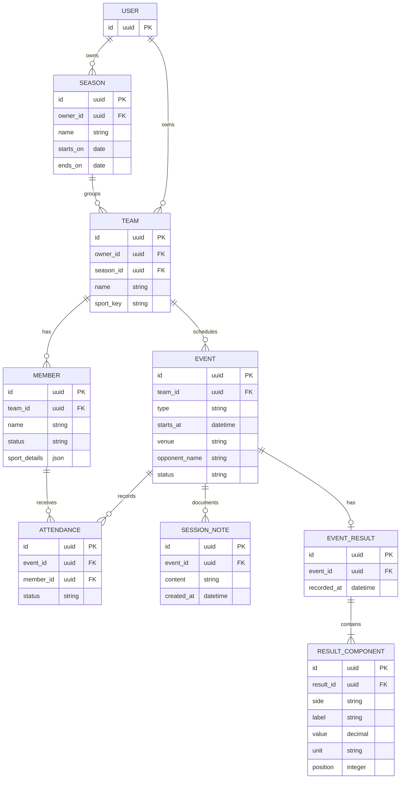
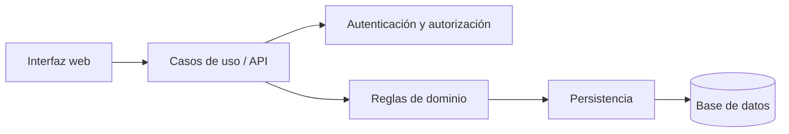

# Team Track — Diseño del prototipo

**Estado:** diseño inicial para la etapa 3  
**Base:** [PRODUCT_DEFINITION.md](PRODUCT_DEFINITION.md) y [REQUIREMENTS.md](REQUIREMENTS.md)  
**Alcance:** prototipo académico de un entrenador y un equipo

## 1. Decisiones para el prototipo

| Decisión | Elección inicial | Motivo |
|---|---|---|
| Usuario y equipos | Un entrenador gestiona un equipo en el flujo de demostración. El modelo conserva propietario y relaciones para permitir varios equipos después. | Mantiene pequeña la primera entrega sin acoplar los datos a un usuario global. |
| Temporadas | Una temporada puede contener varios equipos; cada equipo del prototipo pertenece a una temporada. | Permite reutilizar una temporada si se amplía el alcance. |
| Acceso | Las operaciones se ejecutan en el contexto de un entrenador autenticado; cada consulta y escritura comprueba la propiedad del equipo. | Da una regla concreta para cumplir NFR-03 y evita confiar en filtros de interfaz. |
| Deporte | El deporte es un identificador configurable. Los campos generales no exigen posición, dorsal ni marcador. | Mantiene el núcleo común independiente del baloncesto. |
| Resultado | Se guardan componentes etiquetados por lado, no columnas universales `puntos_local` y `puntos_visitante`. | Permite representar puntos, sets u otros componentes sin afirmar que todos los deportes comparten una puntuación. |
| Datos personales | El prototipo guarda solo el nombre y estado del integrante; no guarda fecha de nacimiento ni datos de contacto. | No son necesarios para los flujos y reducen datos personales almacenados. |
| Asistente de IA | Fuera de la implementación inicial; se mantiene como ampliación P2. | No bloquea el flujo verificable del producto mínimo. |
| Tecnología | Pendiente de los requisitos de la asignatura. Este diseño define responsabilidades y datos, no una biblioteca o proveedor. | No hay código ni tecnologías existentes en el repositorio que condicionen la elección. |

## 2. Casos de uso

### UC-01 — Preparar equipo

**Actor:** entrenador autenticado.  
**Precondición:** el entrenador puede crear datos en su espacio.

1. El entrenador crea una temporada con nombre y fechas opcionales.
2. Crea un equipo con nombre, deporte y temporada.
3. El sistema asigna el equipo al entrenador actual.
4. El sistema confirma y muestra equipo, deporte y temporada.

**Validaciones:** nombre y deporte son obligatorios; la temporada debe existir y pertenecer al mismo entrenador. Un error de validación no guarda datos parciales.

### UC-02 — Gestionar plantilla

**Actor:** entrenador con acceso al equipo.

1. Abre la plantilla del equipo.
2. Añade un integrante con nombre; dorsal, posición y función son opcionales.
3. Puede editar los campos o marcar el integrante como inactivo.
4. El sistema conserva la pertenencia e historial del integrante aunque quede inactivo.

**Regla:** el alta siempre comprueba que el equipo pertenece al entrenador actual. Los campos deportivos opcionales no se exigen ni se presuponen.

### UC-03 — Programar actividad

**Actor:** entrenador con acceso al equipo.

1. Elige entrenamiento o partido.
2. Introduce fecha, hora y, opcionalmente, lugar y notas.
3. El sistema valida fecha y tipo, guarda el evento para ese equipo y lo muestra en la lista ordenada.
4. El entrenador puede editarlo o cancelarlo; cancelar conserva el evento y su historial.

### UC-04 — Registrar entrenamiento

**Actor:** entrenador con acceso al equipo.

1. Abre un entrenamiento y consulta los integrantes activos del equipo.
2. Marca para cada integrante presente, ausente, tarde o justificado.
3. Añade notas generales opcionales.
4. El sistema guarda la asistencia y las notas asociadas al evento.

**Regla de ausencia:** no existe fila de asistencia mientras no se haya registrado. La interfaz la presenta como “sin registrar”, nunca como ausente o cero.

### UC-05 — Registrar resultado de partido

**Actor:** entrenador con acceso al equipo.

1. Abre un partido y registra uno o varios componentes del resultado (por ejemplo, puntos o sets), con etiqueta y valor para cada lado.
2. Puede añadir el nombre del rival como texto si se conoce.
3. El sistema guarda el registro asociado al evento y lo muestra en el historial.

**Regla:** un resultado inexistente se muestra como pendiente. No se calcula un ganador ni se fuerza un formato de marcador que no esté definido para el deporte.

### UC-06 — Consultar panel e historial

**Actor:** entrenador con acceso al equipo.

1. Abre el panel del equipo.
2. El sistema muestra deporte, temporada, integrantes activos, próximos eventos y actividad reciente.
3. Cada elemento se obtiene de los registros del equipo y enlaza a su detalle.
4. Si no hay datos, muestra un estado vacío con la acción disponible para empezar a registrarlos.

**Regla:** los contadores se calculan desde filas guardadas; cualquier dato faltante permanece como faltante. El panel no presenta estimaciones como hechos.

## 3. Modelo de dominio

### Entidades y restricciones

| Entidad | Campos y reglas principales |
|---|---|
| `User` | Identidad autenticada del entrenador. El proveedor de identidad se elige al concretar la tecnología. |
| `Season` | `owner_id`, `name`, `starts_on`, `ends_on` opcional. Si hay fecha final, debe ser igual o posterior a la inicial. |
| `Team` | `owner_id`, `season_id`, `name`, `sport_key`. La temporada y el propietario deben coincidir. `sport_key` procede de un catálogo configurable. |
| `Member` | `team_id`, `name`, `status` (`active` o `inactive`), `sport_details` opcional. Para el prototipo, los detalles específicos se limitan a campos opcionales documentados, sin validar una posición universal. |
| `Event` | `team_id`, `type` (`training` o `match`), `starts_at`, `status` (`scheduled` o `cancelled`), `venue`, `opponent_name` y nota opcionales. La hora se almacena con zona horaria. |
| `Attendance` | Relación única entre evento e integrante; estado (`present`, `absent`, `late`, `excused`). La ausencia de fila significa “sin registrar”. El integrante y evento deben pertenecer al mismo equipo. |
| `SessionNote` | Una o más notas manuales por evento, con fecha de creación. Para la primera interfaz puede presentarse como un único campo de notas. |
| `EventResult` | Como máximo un registro de resultado por partido. Si aún no existe, el resultado está pendiente. |
| `ResultComponent` | Lado (`team` o `opponent`), etiqueta legible, valor y unidad opcional; admite varios componentes ordenados, por ejemplo sets. No almacena cálculos derivados como si fueran entradas. |

**Claves y borrado:** las entidades usan identificadores opacos. Las relaciones históricas (miembro, evento, asistencia y resultado) se conservan mediante baja lógica o restricciones que impidan el borrado en cascada accidental. Los eventos cancelados permanecen en historial.

**Integridad mínima:** `starts_on <= ends_on` cuando la fecha final existe; nombre y deporte no vacíos; valores de asistencia dentro del conjunto permitido; valor de componente numérico válido; unicidad de `(event_id, member_id)` y de `(event_id)` para el resultado. Las operaciones de creación relacionadas con propiedad y asociación se guardan en una transacción.

## 4. Arquitectura lógica

- **Interfaz web:** lista y detalle de equipos, formularios de temporada, plantilla y eventos, registro de asistencia y resultado, panel e historial. Muestra estados de carga, error, vacío y confirmación.
- **Casos de uso/API:** valida las entradas, obtiene la identidad autenticada, comprueba acceso al equipo y coordina lecturas y escrituras. No acepta `owner_id` como autoridad enviado por el navegador.
- **Reglas de dominio:** comprueba tipos de evento, transiciones de estado, asociación de asistencia al mismo equipo y formato de componentes del resultado. No depende del framework de interfaz.
- **Persistencia:** ofrece operaciones por equipo y transacciones para escrituras relacionadas. Todas las consultas incluyen el contexto de propiedad del usuario.
- **Autenticación y autorización:** para la demostración puede usarse una cuenta de entrenador. La implementación concreta se decide con la tecnología; la regla de autorización forma parte del servidor y se refuerza con políticas de base de datos cuando el motor lo permita.

El despliegue inicial puede ser una aplicación web y una base de datos relacional en un único entorno. No se requieren microservicios, colas, almacenamiento de vídeo ni proveedor de IA para cumplir el MVP.

## 5. Operaciones de aplicación

La tecnología final puede exponer estas operaciones como páginas, acciones o endpoints:

| Operación | Entrada principal | Resultado |
|---|---|---|
| Crear temporada | nombre, inicio, fin opcional | temporada del entrenador actual |
| Crear equipo | nombre, deporte, temporada | equipo propiedad del entrenador actual |
| Listar equipos | identidad autenticada | equipos autorizados |
| Añadir/editar/desactivar integrante | equipo, datos del integrante | plantilla actualizada sin perder historial |
| Crear/editar/cancelar evento | equipo, tipo, fecha/hora, opcionales | evento asociado al equipo |
| Registrar asistencia | evento, integrante y estado | registro único por pareja evento-integrante |
| Guardar notas | evento, contenido | nota manual asociada al evento |
| Guardar resultado | partido, componentes etiquetados | resultado y componentes trazables |
| Consultar panel | equipo autorizado, periodo | datos derivados con enlaces a sus registros |

Las respuestas de escritura devuelven el registro persistido para refrescar la vista. Repetir una actualización modifica el registro identificado; las restricciones únicas impiden duplicar asistencia o resultado.

## 6. Seguridad, privacidad y trazabilidad

- Cada lectura y escritura resuelve el equipo y verifica su propietario en el servidor. Un identificador de equipo recibido del cliente no concede acceso.
- Las relaciones validan que temporada, evento e integrante pertenecen al mismo propietario/equipo antes de guardar.
- El prototipo evita fechas de nacimiento, contactos, salud y cualquier dato que no sea necesario para los flujos acordados.
- Las notas son texto introducido por el entrenador. El sistema no las convierte en hechos calculados ni las modifica automáticamente.
- Los resúmenes del panel se calculan a partir de entidades guardadas; la vista conserva acceso al registro de origen.
- Los errores de autorización no revelan si un equipo ajeno existe.

## 7. Consultas del panel

1. **Próximos eventos:** eventos programados del equipo con `starts_at` desde la hora actual, orden ascendente.
2. **Actividad reciente:** últimos eventos del equipo, incluidos cancelados solo si la vista de historial los solicita.
3. **Plantilla activa:** integrantes con `status = active`; el historial puede consultar también inactivos.
4. **Asistencia:** mostrar estados guardados por integrante; falta de fila se representa como no registrada.
5. **Resultados:** mostrar solo componentes guardados y sus etiquetas. No crear ceros, promedios ni ganador si faltan componentes.

Las consultas de panel siempre filtran por equipo autorizado y limitan resultados a una ventana pequeña de actividad, suficiente para la demostración.

## 8. Trazabilidad con requisitos

| Requisitos | Diseño que los cubre |
|---|---|
| FR-01 a FR-04 | `Season`, `Team`, UC-01 y operaciones crear/listar. |
| FR-05 a FR-09 | `Member`, estado activo/inactivo y campos específicos opcionales. |
| FR-10 a FR-13 | `Event`, tipos comunes, cancelación y campos opcionales. |
| FR-14 a FR-18 | `Attendance`, `SessionNote`, `EventResult`, estados pendientes y UC-04/05. |
| FR-19 a FR-21 | UC-06 y consultas del panel con datos de origen y estados vacíos. |
| NFR-02 | Validaciones y restricciones de integridad de este diseño. |
| NFR-03 | Comprobación de propietario en servidor y políticas de persistencia. |
| NFR-04 y NFR-05 | Componentes registrados, consultas trazables y tratamiento explícito de ausencia. |
| NFR-06 y NFR-10 | `sport_key`, detalles opcionales y resultado por componentes etiquetados. |
| NFR-09 | Claves únicas para asistencia y resultado y operaciones de actualización idempotente. |

## 9. Decisiones pendientes antes de elegir tecnología

La estructura del dominio queda definida para iniciar el prototipo. Antes de la etapa 4 hay que contrastar con la asignatura: lenguaje/plataforma exigidos, modo de entrega y si se requiere despliegue. También se decidirá el motor de base de datos y el mecanismo de autenticación en función de esas restricciones. Si se demuestra con datos ficticios y un usuario único local, el modo de acceso puede simplificarse, pero la capa de consultas debe conservar el filtro por propietario.

## 10. Siguiente paso

Etapa 4: seleccionar el entorno permitido por la asignatura e implementar el flujo mínimo de UC-01, UC-02, UC-03 y UC-06; después añadir UC-04 y UC-05. Antes de comenzar la interfaz, validar el esquema con dos deportes mediante datos de ejemplo (baloncesto con puntos y voleibol con sets) para comprobar que los componentes de resultado no imponen una puntuación común.
